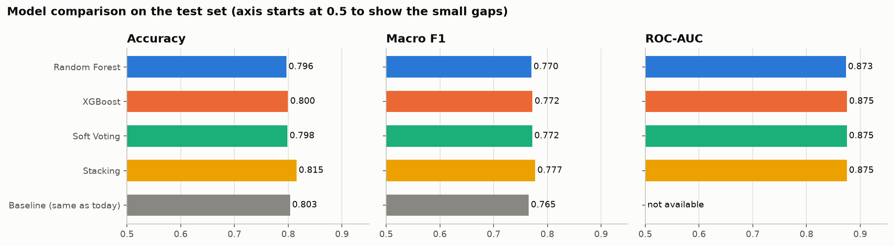
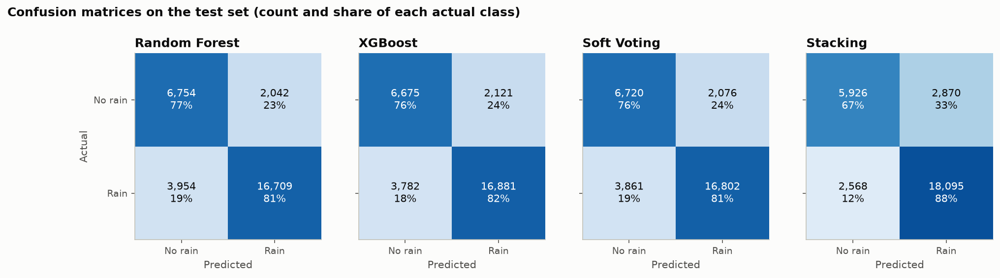
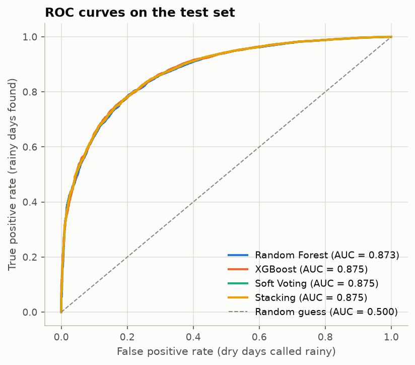
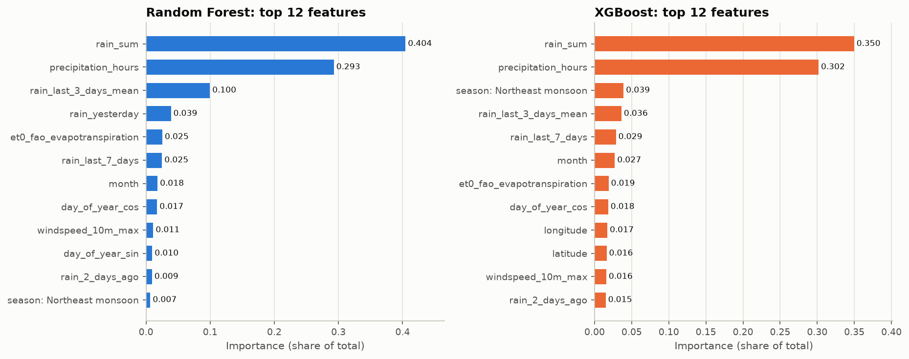
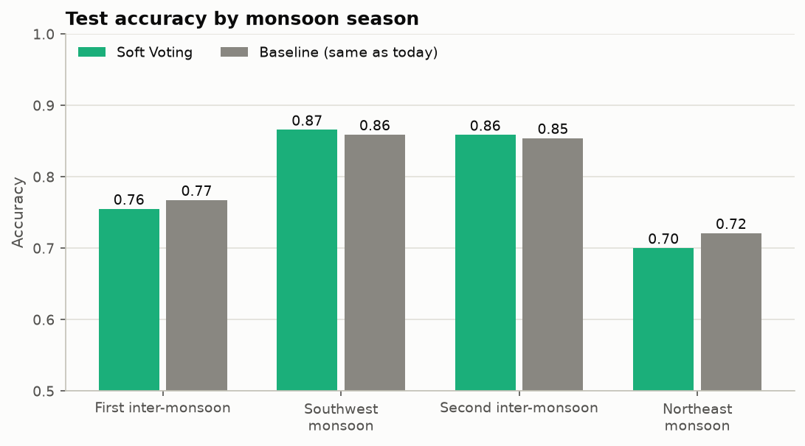
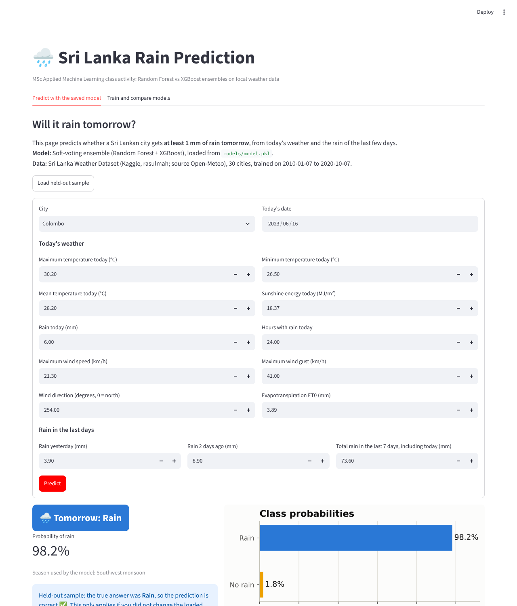
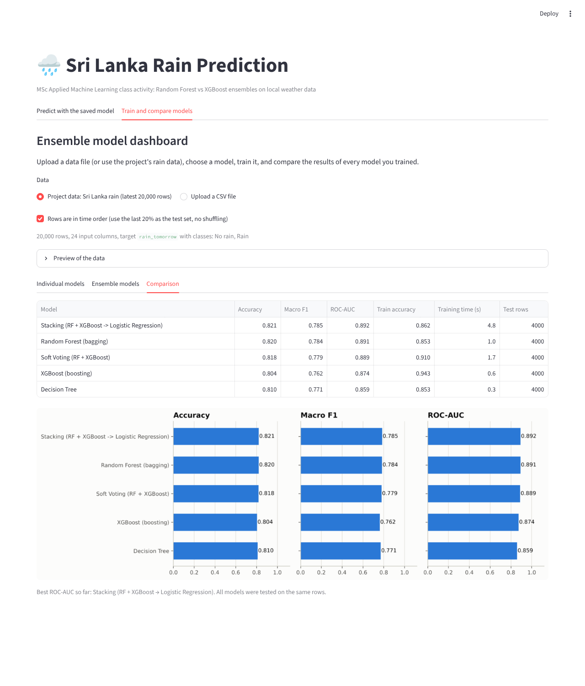
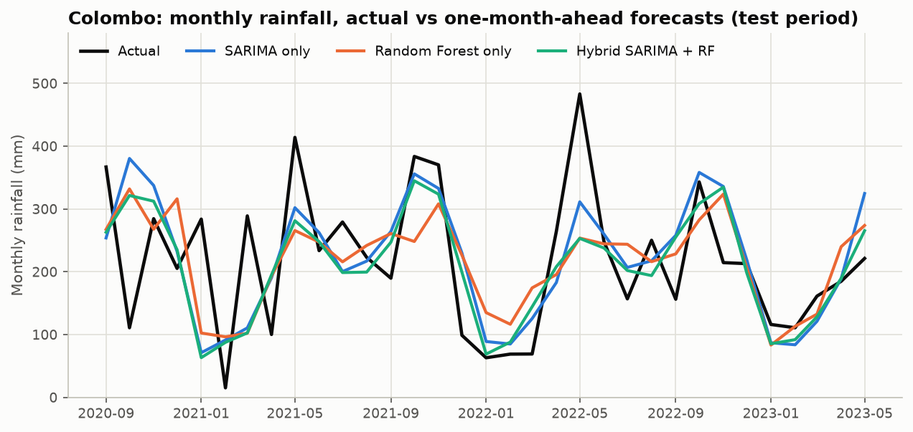

# Will it rain tomorrow? Random Forest vs XGBoost on Sri Lankan weather data

MSc Applied Machine Learning class activity. Random Forest and XGBoost are compared on a local dataset, combined in a soft-voting and a stacking ensemble, exported as a pickle file, and served through a small Streamlit front end.

## 1. Problem statement

**Classification:** given today's weather in a Sri Lankan city and the rain of the last few days, predict whether the city gets **at least 1 mm of rain tomorrow** (`Rain` / `No rain`).

Rain decides daily life here: farming, fishing, travel, construction and flood warnings. A simple, local next-day rain model is a realistic first step, and it is the example the lecturer suggested ("rain or not rain").

## 2. Dataset and why it is local

- **Sri Lanka Weather Dataset** by rasulmah on Kaggle (licence CC0, public domain): https://www.kaggle.com/datasets/rasulmah/sri-lanka-weather-dataset
- Daily weather for **30 Sri Lankan cities**, 1 January 2010 to 17 June 2023: 147,480 rows, 24 columns.
- Source of the values: Open-Meteo historical weather (a weather model, not rain-gauge readings).
- The CSV is included in `data/raw/`, so the project runs without a Kaggle login. `src/download_data.py` can download it again.

Domain knowledge used: the four Sri Lankan climate seasons (two monsoons and two inter-monsoon periods) are a model feature, and the results are read against them.

## 3. Setup

Python 3.12 or 3.13 is recommended.

```bash
python -m venv .venv
.venv\Scripts\activate          # Windows.  On macOS/Linux: source .venv/bin/activate
pip install -r requirements.txt
```

`requirements.txt` pins the versions used to build the saved models. A pickle file is tied to the library versions **and the operating system** that created it. The files in `models/` were built on Windows. If loading `models/model.pkl` fails on your machine (for example on Linux, macOS or Colab), run `python src/train.py` once to rebuild the models.

## 4. How to run each phase

Run every command from the project folder.

| Step | Command | What it does |
|---|---|---|
| 0 | `python src/download_data.py` | Optional: download the CSV from Kaggle again |
| 1 | `python src/preprocess.py` | Null check, cleaning, feature engineering, single-sample hold-out, time-ordered split |
| 2 | `python src/train.py` | Designed parameters, randomized search, Random Forest, XGBoost, soft voting, stacking, pickle export (5 to 10 minutes) |
| 3 | `python src/evaluate.py` | Comparison table and figures in `reports/` |
| 4 | `python src/predict.py` | Loads `models/model.pkl` and predicts the held-out sample |
| 5 | `python src/hybrid_arima_rf.py` | Optional extension: SARIMA + Random Forest hybrid on monthly rainfall |
| 6 | `streamlit run app/app.py` | Front end |

Notebooks (in `notebooks/`, already executed with outputs):

- `01_eda.ipynb`: exploratory data analysis and problem definition.
- `02_model_comparison.ipynb`: **stand-alone comparison notebook** (Random Forest vs XGBoost vs Soft Voting vs Stacking) with interpretation. It needs only the CSV.

## 5. Method in short

- **Preprocessing:** null detection (none found), duplicate and impossible-value checks, removal of constant and repeated columns, `log1p` for skewed rain amounts, `StandardScaler`, one-hot encoding, and median / most-frequent imputers inside the pipeline.
- **Features:** today's weather, rain yesterday and two days ago, 7-day rain total, 3-day rain mean, month, monsoon season, day of year and wind direction as sine and cosine, temperature range, city, latitude, longitude, elevation. All history features use past values only.
- **No leakage:** the split is by time (train 2010-01-07 to 2020-10-07, test 2020-10-08 to 2023-06-16), tuning uses `TimeSeriesSplit`, and preprocessing is fitted on training folds only.
- **Hyperparameters:** every important parameter is set by hand with a reason (see `src/train.py`), then refined with `RandomizedSearchCV`. Designed and tuned values are in `reports/hyperparameters.csv`.
- **Class imbalance (66% Rain):** `class_weight="balanced"` for Random Forest and `scale_pos_weight` for XGBoost.

## 6. Results

Test set: 29,459 city-days. Full report: [`reports/results.md`](reports/results.md).

| Model | Accuracy | Macro F1 | ROC-AUC | Train accuracy | Training time |
|---|---|---|---|---|---|
| Baseline: tomorrow = today | 0.8033 | 0.7653 | not available | 0.8179 | 0 s |
| Random Forest | 0.7965 | 0.7702 | 0.8732 | 0.8325 | 5.0 s |
| XGBoost | 0.7996 | 0.7723 | 0.8753 | 0.8268 | 2.7 s |
| Soft Voting (RF + XGBoost) | 0.7985 | 0.7717 | 0.8750 | 0.8298 | 7.3 s |
| Stacking (RF + XGBoost, Logistic Regression) | **0.8154** | **0.7774** | 0.8750 | 0.8392 | 30.6 s |

These numbers are from the Windows run that produced the files in `models/` and `reports/`. XGBoost gives slightly different results on other operating systems (differences in the third decimal place), and the randomized search can then pick a different XGBoost combination.











**Main findings**

- All models rank days well (ROC-AUC about 0.875), but on plain accuracy they only match the simple rule "tomorrow = today" (0.80), because rain is very persistent.
- The models are better on macro F1 and they give a probability, which the simple rule cannot.
- XGBoost is the best single model: slightly better than Random Forest on accuracy, macro F1 and ROC-AUC, about 2 times faster to train and about 10 times smaller.
- Stacking has the best accuracy, mainly because its meta-learner shifts the decision threshold towards "Rain".
- Errors follow the monsoons: accuracy is about 0.87 in the Southwest monsoon and only about 0.70 in the Northeast monsoon (December to February).

## 7. Strengths and limitations (summary)

| Model | Strengths | Limitations |
|---|---|---|
| Random Forest | Stable, hard to overfit, few sensitive parameters | Slowest and largest single model; relies on two features for about 70% of its importance |
| XGBoost | Best single model, fast, small, strong built-in regularisation | Many interacting parameters; overfits quickly with a high learning rate or deep trees |
| Soft Voting | Simple fixed rule, stable | Adds little here because both members make the same kind of errors |
| Stacking | Learns how to combine the members; best accuracy | About 4 times the training cost of soft voting; the gain is mostly a threshold shift; finds fewer dry days |

Limitations of the whole project: the data is from a weather model with a coarse rain grid (only 15 distinct rain series for 30 cities); pressure, humidity and cloud data are missing; the forecast is for one day ahead only.

## 8. Single-sample inference

One record was removed before the split and never used for training or testing: **Colombo, 16 June 2023**.

```
python src/predict.py
Predicted class : 1 (Rain)
True label      : 1 (Rain)
Result          : CORRECT
```

The model gives this day a rain probability of about 0.98.

## 9. Front end

`streamlit run app/app.py` opens two tabs:

1. **Predict with the saved model:** the pickle loader reads `models/model.pkl`; input boxes for each field; the prediction is shown with its probability. The "Load held-out sample" button fills the form with the held-out record.
2. **Train and compare models:** upload a CSV (or use the project data), choose an individual model (Decision Tree, Logistic Regression) or an ensemble (Random Forest, XGBoost, Gradient Boosting, Soft Voting, Stacking), train it, and compare all trained models.





The prompt used to generate the front end with GenAI is in [`reports/frontend_prompt.md`](reports/frontend_prompt.md).

## 10. Optional extension: hybrid SARIMA + Random Forest

A separate regression experiment on Colombo's monthly rainfall (one-month-ahead forecasts, 33 test months):

| Model | MAE (mm) | RMSE (mm) |
|---|---|---|
| SARIMA only | 73.1 | 96.6 |
| Random Forest only | 81.8 | 101.2 |
| Hybrid SARIMA + Random Forest on residuals | **70.9** | **94.4** |

The hybrid is the best of the three, but the gain over SARIMA alone is small (about 3%) and the test period is short.



## 11. Project structure

```
data/raw/            SriLanka_Weather_Dataset.csv
data/processed/      train.csv, test.csv (created by preprocess.py), inference_sample.csv
notebooks/           01_eda.ipynb, 02_model_comparison.ipynb
src/                 config.py, features.py, preprocess.py, train.py, evaluate.py,
                     predict.py, hybrid_arima_rf.py, download_data.py, plot_style.py
models/              model.pkl (soft voting), random_forest.pkl, xgboost.pkl, stacking.pkl, feature_info.json
app/                 app.py (Streamlit)
reports/             results.md, model_comparison.csv, hyperparameters.csv, frontend_prompt.md, figures/
```

## 12. Activity requirements checklist

| Requirement | Done | Where |
|---|---|---|
| Local Sri Lankan dataset | ✅ | `data/raw/SriLanka_Weather_Dataset.csv` |
| Problem defined (classification) | ✅ | `notebooks/01_eda.ipynb` section 9, this README |
| Preprocessing: null detection, imputation, transformations, normalising, scaling | ✅ | `src/preprocess.py`, `src/features.py` |
| Random Forest and XGBoost with self-designed (non-default) parameters | ✅ | `src/train.py`, `reports/hyperparameters.csv` |
| Performance compared, strengths and limitations stated, results interpreted | ✅ | `src/evaluate.py`, `reports/results.md`, `notebooks/02_model_comparison.ipynb` |
| Single-sample inference on a held-out point | ✅ | `src/predict.py`, `data/processed/inference_sample.csv` |
| Model exported as `.pkl` and loaded back | ✅ | `models/model.pkl`, `src/predict.py` |
| Pickle loader and front-end UI (inputs to prediction) | ✅ | `app/app.py`, tab 1 |
| Soft-voting ensemble (`voting='soft'`) | ✅ | `src/train.py`, `models/model.pkl` |
| Dashboard: upload data, individual and ensemble models, train, compare | ✅ | `app/app.py`, tab 2 |
| Optional: stacking added to the comparison | ✅ | `src/train.py`, `models/stacking.pkl` |
| Optional: ARIMA + Random Forest hybrid | ✅ | `src/hybrid_arima_rf.py` |
| GitHub-ready repository and stand-alone comparison notebook | ✅ | this repository, `notebooks/02_model_comparison.ipynb` |
